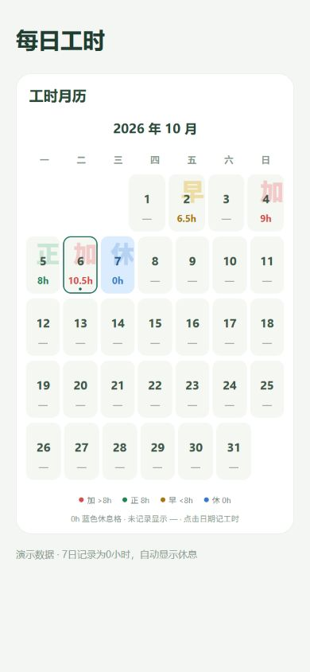

# 每日工时

一款支持 **Android 和 Web** 的本地工时记录工具。记录每天的工作时间，管理加班倍率、调休和工资条，并通过月历与月度对比查看变化。

无需注册账号，工时数据保存在设备或浏览器本地。网页版以静态文件包提供，可自行部署。

[下载安装](https://github.com/xiaojujuovo/daily-work-hours/releases/latest) · [使用说明](使用说明.md) · [网页部署](web/部署说明.md) · [问题反馈](https://github.com/xiaojujuovo/daily-work-hours/issues)

## 适合谁使用

主要面向需要自己记录和核对工时的个人用户，采用按天手动填写总小时数的方式，适合白班工作场景。

- **需要区分加班倍率的上班族**：例如工厂、制造业等按正常、1.5 倍、2 倍、3 倍分别统计工时的岗位。
- **想自己核对工资条的人**：将基础薪资、加班工资、补贴和扣款放在一起，查看每月收入构成及调休抵扣情况。
- **每周工作日不同的人**：例如每周固定工作 4 天或 6 天，或某些工作日超时按 2 倍计算，可按自己的制度设置规则。
- **想保留个人工时账本的人**：通过月历和月度对比了解工时、加班与收入变化，将记录保存在本地，并按需导出备份或表格。

## 功能特性

- **每日记录**：支持补记、修改、删除及备注；工时范围为 0–24 小时，最多保留两位小数。
- **自定义工时规则**：选择每周工作日、正常工时门槛，以及超时按 2 倍计算的工作日；支持手动填写正常、1.5 倍、2 倍和 3 倍工时。
- **倍率自动调平**：调整分类工时时自动从其它分类扣补，保持分类合计与当天总工时一致。
- **工时月历**：显示每天的工时和“休、早、正、加”状态，点击日期即可录入或修改。
- **月度调休**：按 1.5 → 2 → 3 倍的顺序抵扣加班工时，同步调整加班工资，保留原始记录。
- **自定义工资条**：添加基础薪资、补贴、社保、水电费等收入或扣款，支持默认组成与单月自定义。
- **月度对比**：自选两个月，比较出勤、各倍率工时、调休及工资；支持原始／调休后工时切换、差额、变化百分比和 CSV 导出。
- **备份与导出**：支持完整 JSON 备份与恢复，以及工时、工资条和月度对比 CSV 导出。
- **安卓下班提醒**：自定义提醒时间和星期，提供权限状态与通知测试；已保存工时的日期不再提醒。

## 界面预览

以下截图使用演示数据，具体界面以当前版本为准。

| 工时月历 | 工资组成 |
| --- | --- |
|  |  |

## 下载与使用

在 [Releases](https://github.com/xiaojujuovo/daily-work-hours/releases) 下载所需版本。

| 平台 | 文件 | 使用方式 |
| --- | --- | --- |
| Android 7.0 及以上 | `daily-work-hours-<版本>.apk` | 下载后安装；支持 ARM64 和 ARMv7 设备 |
| Web | `daily-work-hours-web-<版本>.zip` | 解压后部署到静态网站服务，通过浏览器访问 |

每个版本提供对应的 SHA256 校验文件。已有官方安卓版本可直接覆盖升级，建议升级前先导出完整备份，不要先卸载。

网页版不提供下班提醒。网页包需要通过 HTTP／HTTPS 访问，不支持直接双击 `index.html`；当前构建使用根路径资源，应部署到域名或子域名的根目录。详细步骤见 [网页部署说明](web/部署说明.md)。

## 工时与工资规则

默认正常工时门槛为 8 小时，可在设置中修改。

| 日期类型 | 默认分配方式 |
| --- | --- |
| 普通工作日 | 门槛内计正常工时，超出部分计 1.5 倍 |
| 指定的 2 倍加班工作日 | 门槛内计正常工时，超出部分计 2 倍 |
| 非工作日 | 全部工时计 2 倍 |
| 3 倍工时 | 手动填写，不自动判断节假日 |

分类工时可以手动调整，保存时合计必须等于总工时。月历以 8 小时区分状态：0 小时为“休”、不足 8 小时为“早”、8 小时为“正”、超过 8 小时为“加”；未记录日期显示横线。这些显示标记与自定义倍率门槛独立。

工资计算方式为：

```text
加班工资 = 调休后 1.5 倍工时 × 基础时薪 × 1.5
         + 调休后 2 倍工时 × 基础时薪 × 2
         + 调休后 3 倍工时 × 基础时薪 × 3

实发合计 = 加班工资 + 自定义收入 − 自定义扣款
```

正常工时不自动折算工资，基础薪资可作为工资条收入项目添加。每条日记录保留保存时的时薪及工资计算开关；修改时薪后，可在统计页的“更多设置”中批量应用到对应月份。同倍率调休按日期从早到晚抵扣，并使用各日保存的时薪。

完整操作说明见 [使用说明](使用说明.md)。

## 数据存储与备份

- **安卓端**：记录保存在应用本地，系统云备份已禁用；卸载应用会清除本地数据。
- **网页端**：记录保存在当前浏览器的 `localStorage` 中，不上传部署服务器。不同浏览器、设备和网址的数据互相独立；清除网站数据或关闭无痕窗口可能清除记录。
- **跨平台迁移**：在一端导出完整 JSON 备份，再到另一端导入；两端不自动同步。导入会替换当前记录与设置，恢复前请先保存现有备份。

项目没有工时业务服务器或服务端数据库。网页只需托管静态文件，生产页面的内容安全策略禁止 API 连接；安卓正式包不申请互联网访问权限。请定期将完整备份保存在应用存储之外。

## 本地开发

### 环境要求

- Git。
- Node.js 24.x（至少 24.3.0）和 npm。
- 构建安卓还需要 JDK 17 与 Android SDK；当前配置使用 Android API 36。

技术栈：React Native、Expo、React、TypeScript、React Native Web 和 AsyncStorage。

### 获取源码

```sh
git clone https://github.com/xiaojujuovo/daily-work-hours.git
cd daily-work-hours
npm ci
```

以下命令可在终端运行。Windows PowerShell 如遇脚本执行策略限制，可将 `npm` 改为 `npm.cmd`、`npx` 改为 `npx.cmd`。

### 启动网页版

```sh
npm run web
```

### 构建静态网页

```sh
npm run build:web
npm run preview:web
```

构建结果位于 `dist/`，本机预览默认地址为 `http://127.0.0.1:8765`。将 `dist/` 中的文件部署到静态网站服务即可，无需配置业务服务器或数据库。

### 构建安卓

在配置好 JDK 17 和 Android SDK 后，可生成原生项目并构建本地 Release 版本：

```sh
npx expo prebuild --platform android
npx expo run:android --variant release
```

自行构建的 APK 使用构建者配置的签名，不能使用不同签名覆盖安装官方版本。分发自己的版本时，请配置并妥善保存自己的签名密钥。

仓库还提供 Windows 构建脚本：[build-android.ps1](scripts/build-android.ps1) 和 [build-in-temp.ps1](scripts/build-in-temp.ps1)。这组脚本依赖项目内的 `.tools/` 工具目录，签名存储在 `.signing/`；工具、缓存和签名文件不随源码提供。使用前应阅读脚本，按要求准备工具，并自行确认接受 Android SDK 许可。

### 运行检查

```sh
npm test
npm run check
```

测试覆盖工时分配、备份校验、调休、工资条、月度对比与提醒逻辑。安卓通知的实际送达及系统权限行为需要在真机上验证。

## 项目结构

```text
App.tsx                   应用入口、记录／统计／设置页面
src/                      工时与工资逻辑、界面组件、存储及平台适配
modules/reminder-access/  安卓提醒权限原生模块
tests/                    自动化测试与示例数据
scripts/                  构建、预览与辅助脚本
assets/                   应用图标等资源
screenshots/              界面截图
web/                      网页部署说明
release/                  版本说明与校验文件
```

安装包和网页压缩包通过 Releases 分发；依赖、编译工具、缓存及签名材料由开发者在本地准备。

## 提醒说明

安卓端使用本地通知，每次打开或回到应用、保存记录或设置时刷新未来 60 天的提醒。长期不打开应用会耗尽已安排的提醒，请至少每月打开一次。

通知需要系统通知与准时提醒权限。手机省电、后台运行和厂商系统策略可能影响送达，可在设置中查看提醒状态并运行测试。网页版不请求通知权限。

## 参与贡献

欢迎通过 [Issues](https://github.com/xiaojujuovo/daily-work-hours/issues) 提交问题或功能建议。报告问题时，请说明应用版本、平台、复现步骤、预期行为与实际结果，并使用示例数据代替个人工时和工资信息。

提交 Pull Request 前，请运行 `npm test` 和 `npm run check`，并为涉及计算规则的变更补充测试。请勿提交真实用户备份、签名密钥或本机编译工具。

## 作者

[xiaojuju](https://github.com/xiaojujuovo)

## 许可证

本项目采用 [MIT License](LICENSE)。第三方依赖遵循各自的许可证。
